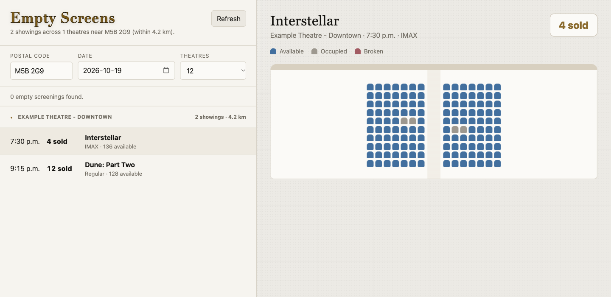

# Empty Screens

**Find a quieter movie night.**

Empty Screens compares nearby Cineplex reserved-seating showtimes by occupied-seat count, then lets you inspect the seating layout before choosing a screening.

[Live app](https://emptyscreens.gurmanothi.com) · [How it works](#how-it-works) · [Run locally](#run-locally)



*Interface preview with illustrative screening data, not live availability.*

## Why I Built It

Choosing a movie time usually means opening seat maps one by one. This project brings that comparison into one view: nearby theatres, showtimes, occupied counts, and the seats themselves.

## What It Does

- Search by Canadian postal code and date.
- Compare reserved-seating screenings across nearby theatres.
- Order theatres by distance, then sort each theatre's screenings by occupied seats and time.
- Stream completed theatre results into the page instead of waiting for every request.
- Browse showtimes grouped by theatre.
- Inspect available, occupied, and broken seats on a visual map.
- Fall back to Toronto when no location is supplied.

Seat availability is a snapshot, not a guarantee that a room will stay quiet. The app does not reserve seats or complete purchases.

## How It Works

```text
Postal code + date
        |
        v
Node.js HTTP server
        |
        +-- Postal-code lookup: Nominatim / Zippopotam.us
        |
        +-- Cineplex theatre and showtime endpoints
        |
        +-- Seat layout + seat availability
        |
        v
Occupied-seat counts -> ranked screenings -> browser seat map
```

The server keeps the upstream subscription header out of browser requests. It caches upstream responses, coalesces identical in-flight requests, and uses bounded worker pools for theatres and per-theatre seat counts. Results stream as newline-delimited JSON, so the browser can show finished theatres while others are still loading. New searches abort the previous browser request. Request timeouts, input checks, per-IP throttling, and security headers keep the boundary small and explicit.

## Stack

| Layer | Implementation |
| --- | --- |
| UI | Vanilla JavaScript, HTML, CSS |
| Server | Node.js built-in HTTP server |
| State | In-memory caches and request tracking |
| External data | Cineplex endpoints; postal-code geocoding |
| Results transport | NDJSON with streamed per-theatre updates |
| Runtime dependencies | None |

## Run Locally

Use **Node.js 22+**. There are no packages to install.

```sh
git clone https://github.com/gmnothi/CineplexEmptySeat.git
cd CineplexEmptySeat
cp .env.example .env
```

Optionally set `CINEPLEX_API_KEY` in your local `.env` to override the existing public-key fallback, then start:

```sh
node --env-file=.env server.js
```

Open [localhost:4173](http://localhost:4173).

For a host that injects environment variables, use `npm start`. It does not automatically read a `.env` file.

The existing subscription-key fallback is retained for compatibility. Availability still depends on the upstream endpoints; you can override the key without changing source code.

### Configuration

| Variable | Purpose |
| --- | --- |
| `CINEPLEX_API_KEY` | Optional override for the existing upstream subscription key |
| `APP_USER_AGENT` | App identifier/contact for postal-code geocoding |
| `PORT` | HTTP port; defaults to `4173` |
| `NODE_ENV` | Set to `production` to hide upstream error details |
| `DEFAULT_LAT`, `DEFAULT_LNG` | Fallback coordinates |
| `DEFAULT_THEATRES`, `MAX_THEATRES` | Theatre search bounds |
| `SHOWTIME_FETCH_CONCURRENCY`, `SEAT_FETCH_CONCURRENCY` | Theatre and per-theatre seat-count worker pools |
| `API_RATE_LIMIT`, `API_RATE_WINDOW_MS` | Per-IP request limit |
| `FETCH_TIMEOUT_MS` | Upstream request timeout |
| `UPSTREAM_CACHE_TTL_MS` | Upstream response cache lifetime |

See [.env.example](.env.example) for defaults.

## API

| Endpoint | Description |
| --- | --- |
| `GET /healthz` | Lightweight server health check |
| `GET /api/showings?postalCode=M5B%202G9&date=YYYY-MM-DD&theatres=12` | Streamed theatre results and ranked seat counts |
| `GET /api/seatmap?theatreId=...&showtimeId=...` | Layout and availability for one screening |

`/api/showings` returns `application/x-ndjson`: `meta`, `theatre`, `theatreError`, `done`, or `error` events. Clients must handle stream-level errors even after an HTTP 200 response. `/api/seatmap` returns ordinary JSON.

## Checks

```sh
npm run check
```

This checks server and browser syntax, plus HTTP smoke tests for static delivery, health, security headers, and unsupported methods. It does not verify live upstream access.

## Deployment & Limitations

A [Dockerfile](Dockerfile) is included for a long-running Node service. Caches and rate limits are process-local: multiple replicas do not share them, and restarting clears them.

The app depends on third-party endpoints, availability, and permission to access them. A live page does not prove that the upstream service is currently responding. Broken and unknown seat states are not counted as occupied; disabled, sold-out, and non-reserved showtimes are filtered according to the upstream fields.

The upstream subscription key is not a Cineplex account login. Public accessibility of an endpoint or key does not grant a license to redistribute its data or bypass provider restrictions. Keep any personal credentials or private overrides out of source control.

## Attribution

Independent project; not affiliated with or endorsed by Cineplex. Movie, theatre, and seating information comes from Cineplex services. Postal-code lookup uses Nominatim/OpenStreetMap, with Zippopotam.us as a fallback. Access to third-party data is subject to the respective providers' terms; this repository does not grant those rights.
